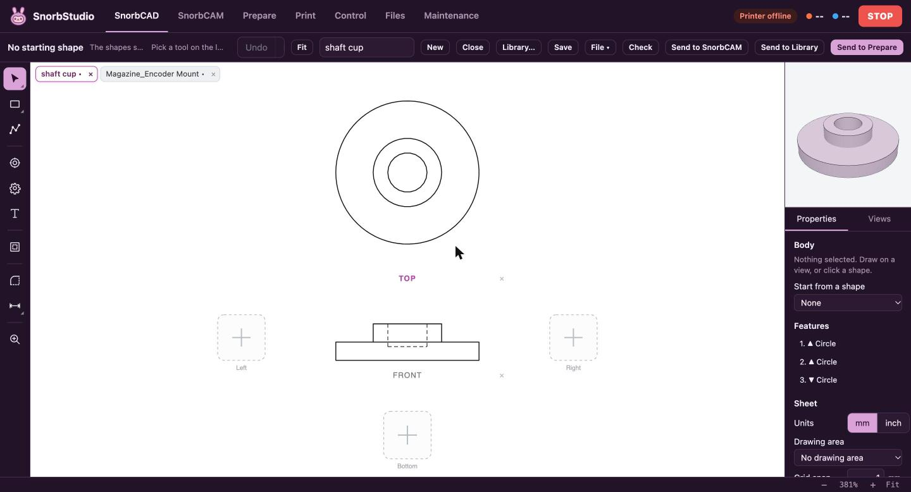

# SnorbStudio

A web app for a Klipper 3D printer, made by SnorbWorks. It runs on the Raspberry Pi
next to the printer, and you use it in a browser on the same network.



- **SnorbCAD**: design parts by drawing in drafting views (top, front, side, ...).
  It builds the 3D part as you draw, and has gears, fillets, dimensions, patterns,
  and STL bodies from the library.
- **SnorbCAM**: turn SVG, DXF or SnorbCAD drawings into G-code for a CNC router
  (profiles, pockets, tabs, ramps, roughing and finishing passes; made for a ShopBot).
- **Prepare**: arrange models on the bed and slice them with PrusaSlicer on the Pi.
- **Print / Control / Files / Maintenance**: run the printer through Moonraker.
  Maintenance also handles updates from this repo.

## What you need

- A 3D printer running [Klipper](https://www.klipper3d.org/) and
  [Moonraker](https://github.com/Arksine/moonraker) on a Raspberry Pi (built on an
  Ender 3 with a CR Touch, a V4.2.2 board and Raspberry Pi OS).
- [PrusaSlicer](https://github.com/prusa3d/PrusaSlicer) on the Pi for slicing, and nginx
  (already there if you installed Mainsail).
- Any modern browser on the same network.

## Layout

| Folder | What's in it |
|---|---|
| `web/` | The page nginx serves (plain JS, plus SnorbCAD's built bundle in `web/design/`) |
| `design/` | SnorbCAD source (TypeScript, replicad/OpenCASCADE). `npm test` builds it into `web/design/` |
| `server/` | Python helper on port 8091: model library, slicing, designs, self-updater |
| `deploy/` | Installer, systemd unit, nginx site, Klipper macros |
| `profiles/` | Slicer profiles |
| `klipper_extras/` | Klipper add-ons the installer copies in |

## Install on the Pi

```sh
git clone https://github.com/SnorbWorks/snorbstudio ~/snorbstudio
sh ~/snorbstudio/deploy/install.sh
```

## Publish an update

Commit on the Mac, then run `sh deploy/push.sh`. The Pi installs the update when
the printer is idle, and rolls back if SnorbStudio or Klipper doesn't come back up.

The built `web/design/` is committed, because the Pi never builds anything.

## License

MIT, see `LICENSE`. The Klipper add-ons in `klipper_extras/` are GPL-3.0, like
Klipper itself. Bundled third-party code is listed in `THIRD_PARTY.md`.
